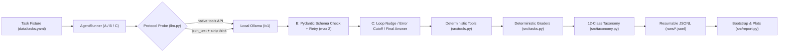
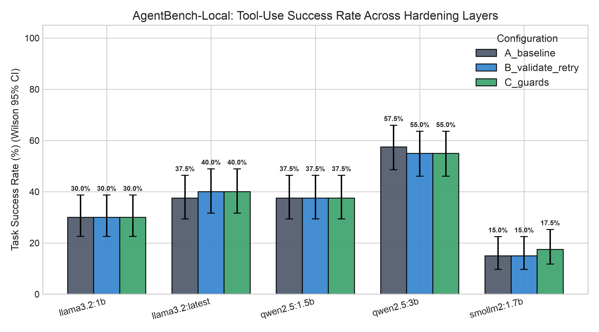
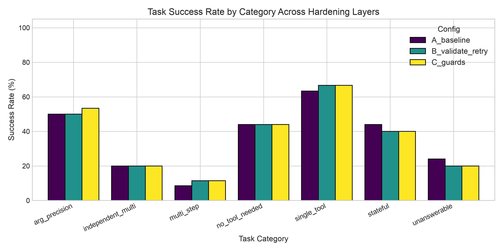
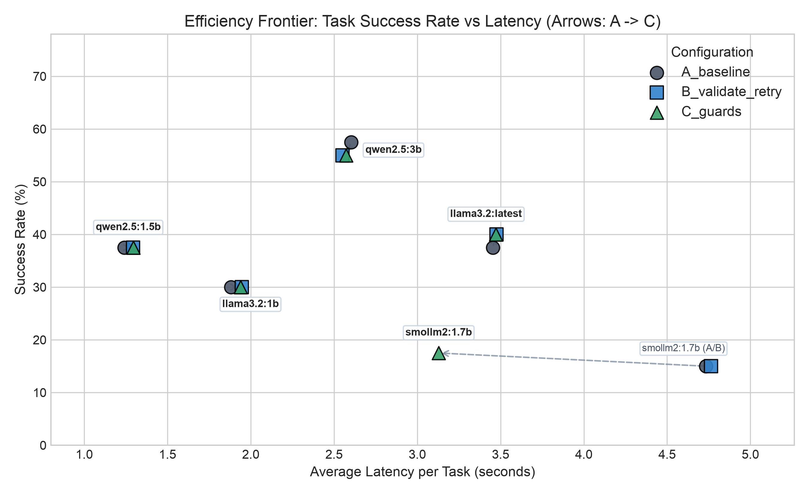
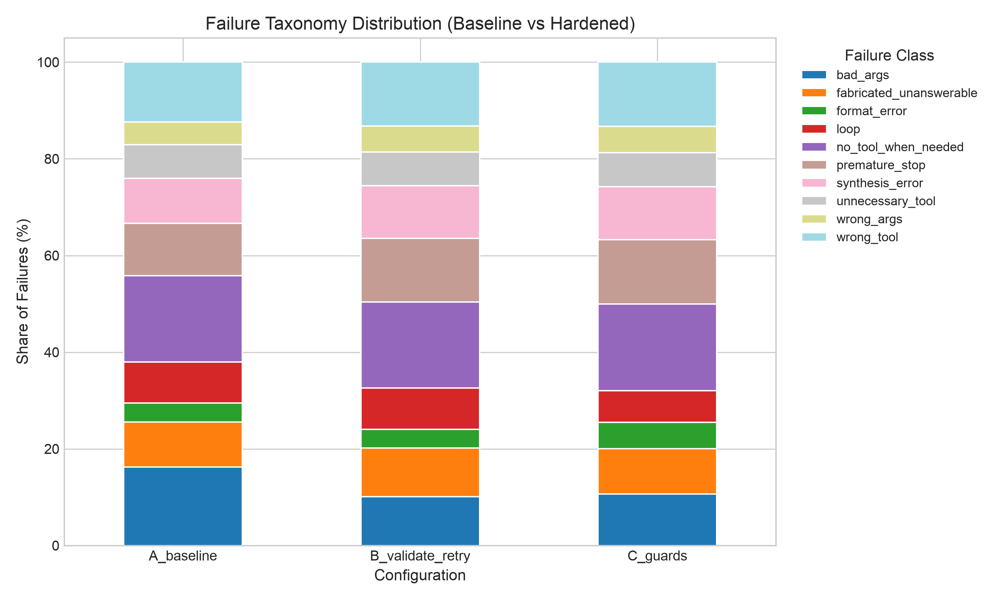

# AgentBench-Local: Reliability Benchmark & Hardening Layer for Local Tool-Calling LLMs

**AgentBench-Local** is a lightweight, framework-free reliability benchmark and runtime hardening harness for tool-calling agents running on small local LLMs via Ollama. It evaluates 5 local models (`llama3.2:1b`, `llama3.2:latest`, `qwen2.5:1.5b`, `qwen2.5:3b`, `smollm2:1.7b`) across a 60-task deterministic suite (20 dev / 40 frozen test, 3 test repeats = **1,800 frozen test runs** / **2,100 total logged trajectories**), quantifies uncertainty with Wilson 95% intervals and 10,000-resample paired bootstrap tests, and audits a 12-class automated failure taxonomy against manual trajectory review.

> **Headline Finding:** On frozen 40-task evaluation across 5 small local models (<= 3.2B params), adding Pydantic validation-retry and loop/step guards moved overall task success from **35.5%** (`213/600`) to **36.0%** (`216/600`) — lifting `llama3.2:latest` (**37.5% -> 40.0%**, paired-bootstrap 95% CI `[-5.0%, +12.5%]`, `p = 0.7617`) and `smollm2:1.7b` (**15.0% -> 17.5%**, 95% CI `[+0.0%, +7.5%]`, `p = 0.6242`), with **no end-to-end pass-rate delta reaching statistical significance (`p >= 0.624`)**. However, hardening raised `llama3.2:latest` tool-call validity from **68.3% to 97.6% (+29.3 pp)** (cutting `bad_args` **87.5%** from `24 -> 3`), cut `smollm2:1.7b` average tokens **-45.8%** (`7,779 -> 4,213`) and latency **-33.8%** (`4.73s -> 3.13s`), and categorized remaining failures across **12 taxonomy classes** (10 observed in test) with **45.0% (`9/20`)** auto-vs-human audit agreement.

---

## Architecture & Hardening Stack



### Ablation Configurations (`src/agent.py`)

All configurations use `temperature=0.2`, `seed=42`, per-call timeout (`90.0s`), `max_steps=8`, and an identical base system prompt logged by SHA-256 prefix (**`ad51ec97de11`** across all 1,800 test trajectories):

| Config | Mechanism Added | Purpose |
| --- | --- | --- |
| **`A_baseline`** | Naive dispatch; single try per step; unvalidated arguments sent directly to tool executor | Unhardened baseline |
| **`B_validate_retry`** | Pre-execution Pydantic schema check against [`CalculatorArgs`](src/tools.py), [`SearchFilesArgs`](src/tools.py), [`ReadFileArgs`](src/tools.py), [`CalendarArgs`](src/tools.py), [`RunPythonArgs`](src/tools.py) + `json_text` format check; returns structured field errors for up to `2` retries/step | Isolate schema-repair gains |
| **`C_guards`** | **`B`** + duplicate `(tool, args)` loop detection (`repeat == 2` injects nudge), consecutive validation-error cutoff, and forced-answer prompt on step 8 | Bound infinite retry/loop waste |

### Dual Tool-Calling Protocol (`src/llm.py`)

[`LLMClient.probe_protocol`](src/llm.py) automatically probes each Ollama model once per run:
1. **`native`**: Uses the OpenAI `tools` parameter (all 5 laptop test models — `llama3.2:1b`, `llama3.2:latest`, `qwen2.5:1.5b`, `qwen2.5:3b`, `smollm2:1.7b` — probed `native`).
2. **`json_text`**: Fallback strict JSON protocol (`{"tool": ..., "args": {...}}` or `{"final_answer": ...}`) with `<think>...</think>` stripping (`strip_think_blocks`), reasoning-field extraction, `max_tokens >= 2048` budget, and format-error retries for reasoning models such as `deepseek-r1`.

---

## Benchmark Design: 4 Tools, 15 Sandbox Files, 60 Tasks

### Deterministic Tools (`src/tools.py`)

| Tool | Interface & Constraints | Safety / Determinism |
| --- | --- | --- |
| `calculator` | `expression: str` supporting `+ - * / // % **` and `abs, round, min, max, pow, sqrt, ceil, floor` | Safe AST walker (`_eval_ast_node`); no `eval`/`exec` |
| `search_files` / `read_file` | Keyword search (`max_results`) and file reads over 15 files in [`data/sandbox/`](data/sandbox) (`.csv`, `.json`, `.md`, `.txt`) | `_sanitize_path` blocks path traversal (`..` / external paths) |
| `calendar` | `action: "create" \| "list" \| "delete"`, ISO `YYYY-MM-DD`, 24h `HH:MM`, `event_id` | In-memory store reset per task via `calendar_reset(fixture)` |
| `run_python` | `code: str` executed in subprocess | `5.0s` timeout, isolated temp subdir inside sandbox |

### Task Split & Categories (`data/tasks.yaml`)

- **20 `dev` tasks** (1 repeat/config) used during harness & `json_text` development.
- **40 frozen `test` tasks** (3 repeats/config = `120` runs per model-config pair), graded without LLM judges (`grade_numeric`, `grade_string_contains`, `grade_regex`, `grade_unanswerable`, `grade_no_tool`, `grade_calendar_state`, plus composite graders):

| Category | Dev | Test | Grading Focus |
| --- | --- | --- | --- |
| `single_tool` | 4 | 6 | Direct lookup or arithmetic precision |
| `multi_step` | 3 | 7 | Dependent chains (search/read -> compute/synthesize) |
| `independent_multi` | 2 | 6 | Multi-entity lookups aggregated together |
| `arg_precision` | 3 | 6 | ISO dates, rounding expressions, filtering criteria |
| `no_tool_needed` | 3 | 5 | General-knowledge / greeting distractors (`tool_calls == []`) |
| `unanswerable` | 2 | 5 | Missing sandbox info; requires stating unavailability |
| `stateful` | 3 | 5 | Multi-mutation `calendar` workflows graded on final state |
| **Total** | **20** | **40** | All 60 verified solvable in [`tests/test_tasks.py`](tests/test_tasks.py) |

---

## Frozen Test Split Results (`1,800` Runs Across 5 Local Models)

Hardware: Apple MacBook Pro M3, 18 GB unified memory (`Darwin arm64`, Ollama `0.24.0`), executed sequentially one model at a time with `15s` cooldowns between configurations.

### Primary Benchmark Summary (`results/summary_metrics.csv`)

| Model | Params / Quant | Protocol | Config | Runs | Passed | Success Rate | 95% CI (Wilson) | Tool Validity | Avg Steps | Avg Latency (s) | Avg Tokens |
| --- | --- | --- | --- | --- | --- | --- | --- | --- | --- | --- | --- |
| `llama3.2:1b` | 1.2B / `Q8_0` | `native` | `A_baseline` | 120 | 36 | 30.0% | `[22.5%, 38.7%]` | 71.4% | 1.88 | 1.88 | 1038 |
| `llama3.2:1b` | 1.2B / `Q8_0` | `native` | `B_validate_retry` | 120 | 36 | 30.0% | `[22.5%, 38.7%]` | **77.1%** | 1.88 | 1.95 | 1344 |
| `llama3.2:1b` | 1.2B / `Q8_0` | `native` | `C_guards` | 120 | 36 | 30.0% | `[22.5%, 38.7%]` | **77.1%** | 1.88 | 1.94 | 1344 |
| `llama3.2:latest` | 3.2B / `Q4_K_M` | `native` | `A_baseline` | 120 | 45 | 37.5% | `[29.4%, 46.4%]` | 68.3% | 2.02 | 3.45 | 1068 |
| `llama3.2:latest` | 3.2B / `Q4_K_M` | `native` | `B_validate_retry` | 120 | 48 | **40.0%** | `[31.7%, 48.9%]` | **97.6%** | 2.02 | 3.48 | 1115 |
| `llama3.2:latest` | 3.2B / `Q4_K_M` | `native` | `C_guards` | 120 | 48 | **40.0%** | `[31.7%, 48.9%]` | **97.6%** | 2.02 | 3.47 | 1115 |
| `qwen2.5:1.5b` | 1.5B / `Q4_K_M` | `native` | `A_baseline` | 120 | 45 | 37.5% | `[29.4%, 46.4%]` | 87.1% | 1.77 | **1.24** | 1471 |
| `qwen2.5:1.5b` | 1.5B / `Q4_K_M` | `native` | `B_validate_retry` | 120 | 45 | 37.5% | `[29.4%, 46.4%]` | 84.4% | 1.80 | 1.29 | 1502 |
| `qwen2.5:1.5b` | 1.5B / `Q4_K_M` | `native` | `C_guards` | 120 | 45 | 37.5% | `[29.4%, 46.4%]` | 84.4% | 1.80 | 1.29 | 1502 |
| `qwen2.5:3b` | 3.1B / `Q4_K_M` | `native` | `A_baseline` | 120 | 69 | **57.5%** | `[48.6%, 66.0%]` | 100.0% | 1.85 | 2.60 | 1591 |
| `qwen2.5:3b` | 3.1B / `Q4_K_M` | `native` | `B_validate_retry` | 120 | 66 | 55.0% | `[46.1%, 63.6%]` | 100.0% | 1.82 | 2.55 | 1570 |
| `qwen2.5:3b` | 3.1B / `Q4_K_M` | `native` | `C_guards` | 120 | 66 | 55.0% | `[46.1%, 63.6%]` | 100.0% | 1.82 | 2.57 | 1570 |
| `smollm2:1.7b` | 1.7B / `Q8_0` | `native` | `A_baseline` | 120 | 18 | 15.0% | `[9.7%, 22.5%]` | 90.6% | 4.53 | 4.73 | 7779 |
| `smollm2:1.7b` | 1.7B / `Q8_0` | `native` | `B_validate_retry` | 120 | 18 | 15.0% | `[9.7%, 22.5%]` | 95.6% | 4.53 | 4.76 | 7804 |
| `smollm2:1.7b` | 1.7B / `Q8_0` | `native` | `C_guards` | 120 | 21 | **17.5%** | `[11.7%, 25.3%]` | **96.6%** | **3.25** | **3.13** | **4213** |

Across all 600 test trajectories per configuration (`5` models combined):
- **Task Success Rate:** `A_baseline = 35.50%` (`213/600`) | `B_validate_retry = 35.50%` (`213/600`) | `C_guards = 36.00%` (`216/600`)
- **Efficiency (`A -> C`):** Mean steps **`2.41 -> 2.15`** (`-10.8%`), mean latency **`2.78s -> 2.48s`** (`-10.8%`), mean tokens/task **`2,590 -> 1,949`** (`-24.7%`)



### Paired-Bootstrap Hypothesis Tests (`results/bootstrap_deltas.csv`)

10,000 paired task-level bootstrap resamples per model (`40` tasks, averaged over `3` repeats):

| Model | Comparison | Delta (% points) | 95% CI (Bootstrap) | p-value | Significant? |
| --- | --- | --- | --- | --- | --- |
| `llama3.2:1b` | A vs B (Validation) | `+0.0%` | `[-7.5%, +7.5%]` | `1.0000` | No |
| `llama3.2:1b` | A vs C (Hardened) | `+0.0%` | `[-7.5%, +7.5%]` | `1.0000` | No |
| `llama3.2:latest` | A vs B (Validation) | `+2.5%` | `[-5.0%, +12.5%]` | `0.7617` | No |
| `llama3.2:latest` | A vs C (Hardened) | `+2.5%` | `[-5.0%, +12.5%]` | `0.7617` | No |
| `qwen2.5:1.5b` | A vs B (Validation) | `+0.0%` | `[+0.0%, +0.0%]` | `1.0000` | No |
| `qwen2.5:1.5b` | A vs C (Hardened) | `+0.0%` | `[+0.0%, +0.0%]` | `1.0000` | No |
| `qwen2.5:3b` | A vs B (Validation) | `-2.5%` | `[-7.5%, +0.0%]` | `0.6267` | No |
| `qwen2.5:3b` | A vs C (Hardened) | `-2.5%` | `[-7.5%, +0.0%]` | `0.6267` | No |
| `smollm2:1.7b` | A vs B (Validation) | `+0.0%` | `[+0.0%, +0.0%]` | `1.0000` | No |
| `smollm2:1.7b` | A vs C (Hardened) | `+2.5%` | `[+0.0%, +7.5%]` | `0.6242` | No |

### Category Breakdown & Latency Frontier (`results/category_metrics.csv`)

| Category | `A_baseline` | `B_validate_retry` | `C_guards` | Test Runs / Config |
| --- | --- | --- | --- | --- |
| `single_tool` | 63.3% | **66.7%** | **66.7%** | 90 |
| `arg_precision` | 50.0% | 50.0% | **53.3%** | 90 |
| `no_tool_needed` | 44.0% | 44.0% | 44.0% | 75 |
| `stateful` | 44.0% | 40.0% | 40.0% | 75 |
| `unanswerable` | 24.0% | 20.0% | 20.0% | 75 |
| `independent_multi` | 20.0% | 20.0% | 20.0% | 90 |
| `multi_step` | 8.6% | **11.4%** | **11.4%** | 105 |





---

## Failure Taxonomy & Manual Audit (`src/taxonomy.py`, `src/review_failures.py`)

Every failed run (`1,158` test failures across `A`/`B`/`C`) is automatically assigned a single primary class using fixed priority rules (`timeout -> format_error -> hallucinated_tool -> bad_args -> unnecessary_tool -> no_tool_when_needed -> fabricated_unanswerable -> wrong_tool -> wrong_args -> loop -> premature_stop -> synthesis_error`). Ten of the 12 classes occurred in test runs (`hallucinated_tool` and `timeout` recorded `0` occurrences):

| Failure Class | `A_baseline` | `B_validate_retry` | `C_guards` | `A -> C` Shift |
| --- | --- | --- | --- | --- |
| `no_tool_when_needed` | 69 | 69 | 69 | `0` |
| `bad_args` | 63 | **39** | **41** | **`-22` (`-34.9%`)** |
| `premature_stop` | 42 | 51 | 51 | `+9` |
| `wrong_tool` | 48 | 51 | 51 | `+3` |
| `synthesis_error` | 36 | 42 | 42 | `+6` |
| `fabricated_unanswerable` | 36 | 39 | 36 | `0` |
| `loop` | 33 | 33 | **25** | **`-8` (`-24.2%`)** |
| `unnecessary_tool` | 27 | 27 | 27 | `0` |
| `wrong_args` | 18 | 21 | 21 | `+3` |
| `format_error` | 15 | 15 | 21 | `+6` |
| **Total Failures** | **387** | **387** | **384** | **`-3`** |

Per-model failure counts are stored in [`results/failure_taxonomy.csv`](results/failure_taxonomy.csv).



### Key Engineering Insights ("What Worked vs. What Shifted Downstream")

1. **Syntactic Validation Unblocked Calls, Exposing a Multi-Step Planning Ceiling:** On `llama3.2:latest`, `B_validate_retry` slashed `bad_args` errors from **24 to 3** (`-87.5%`) and raised tool validity from **68.3% to 97.6%**. However, once calls executed cleanly, failed runs shifted downstream into **`premature_stop` (`6 -> 15`)**, leaving end-to-end pass rate at `+2.5%` (`n.s.`). Across all models, `multi_step` success stalled at **11.4%** (`independent_multi` at **20.0%**).
2. **Loop Guards Yielded Major Compute Savings Even Without Accuracy Jumps:** `smollm2:1.7b` spent up to 8 steps repeating identical tool calls in `A`/`B` (`33` `loop` failures, `7,779` avg tokens). Enabling `C_guards` cut tokens by **-45.8%** and latency by **-33.8%** while nudging `C_guards` pass rate up `+2.5 pp`.
3. **Why Semantic Failures Dominated Capable Models:** `qwen2.5:3b` achieved **100.0% tool-call validity** in every config (`bad_args = 0`), yet scored `55.0%–57.5%` because of **`no_tool_when_needed` (`24` runs)** and **`fabricated_unanswerable` (`9` runs)**. Note that its `-2.5%` `A` vs `B`/`C` difference (`69/120` vs `66/120`) came from `temperature=0.2` sampling variance on a single `stateful` task (`test_40`, `p = 0.6267`).
4. **Ollama Parser Silent Drops:** Auditing `qwen2.5:3b` blank outputs (`content=""` with `21` completion tokens and `tool_calls=None`) traced the failure to Ollama's `<tool_call>` template parser stripping malformed XML/JSON tool invocations without returning raw text or throwing an HTTP error.

### Manual Failure Audit (`9/20 = 45.0%` Agreement)

We randomly sampled `20` failed `test` trajectories (`seed=42`, [`src/review_failures.py`](src/review_failures.py)) and audited every trace by hand in [`results/manual_review_audit.csv`](results/manual_review_audit.csv). Auto-vs-manual agreement was **9/20 (45.0%)**, revealing 4 systematic weaknesses in rule-based taxonomy classification:
- **Path `NOT_FOUND` vs. `format_error` (4/20 disagreements):** `read_file` calls with valid JSON and string types that passed `/data/sandbox/...` or hallucinated `"base_rates.json"` triggered `format_error` in the auto-classifier; manually these are **`wrong_args`**.
- **Leaked / Swallowed Tool Calls (3/20 disagreements):** Raw text outputs like `{"name": "round", ...}` (`llama3.2:1b`), `<tool_response>[...]</tool_response>` (`smollm2:1.7b`), and Qwen2.5 blank `""` outputs with `21` completion tokens returned `tool_calls=None` over the wire, mislabeling **`format_error`** as `no_tool_when_needed` or `synthesis_error`.
- **Direct File Reads vs. `expected_tools` Order (2/20 disagreements):** Calling `read_file("meeting_notes.md")` or `read_file("vendor_contracts.csv")` directly when the filename is in the prompt skipped `search_files`, causing `expected_tools`-based rules to mislabel complete reads as `premature_stop` (`test_12`, true error: `synthesis_error`) or `wrong_tool` (`test_09`, true error: `premature_stop` skipping `calculator`).
- **Deterministic Unanswerable Grader Sensitivity (2/20 disagreements):** On `test_34`, `llama3.2:latest` inspected `shipping_rates.json` and replied that the return policy was `"not explicitly mentioned... does not specify"`, failing `grade_unanswerable`'s exact substring list (`"not mentioned"` != `"not explicitly mentioned"`) — a **`grader_false_negative`** outside model failure classes; on `test_32`, `llama3.2:latest` guessed a nonexistent path (`wrong_args`) without fabricating PII.

---

## Dev-Split Diagnostics & Off-Laptop GPU Models

Heavy models (>= 7B) and slow chain-of-thought models were probed for protocol compatibility and excluded from the 360-run M3 laptop test sweep due to thermal/latency constraints:

- **`deepseek-r1:1.5b` (`json_text`, Reasoning Strip + Format Retry):** Probed `json_text` (Ollama returned HTTP 400 `"does not support tools"`). On a 5-task `dev` subset (`dev_01`–`dev_05`) with `max_tokens=2048` and `parse_error` retry, `A_baseline` scored `0/5` (`4` `format_error`s, `45.6s`), `B_validate_retry` recovered `dev_01` to `1/5` (`156.7s`), and `C_guards` forced a final answer at step 8 on `dev_03` (`1/5`, `162.1s`). Average `~32s/task` makes a 360-run test sweep impractical on CPU/laptop (~2.5h), so reasoning sweeps belong on GPU.
- **`gemma4:e4b` (`8.0B`, `Q4_K_M`, 9.6 GB):** Completed `dev_01` in `7.43s` and stalled `>4.5 min` on `dev_02` on 18 GB unified memory. Moved to the Kaggle T4/GPU notebook alongside `qwen2.5:7b`, `qwen3.5:9b`, and `deepseek-r1:14b` in [`notebooks/kaggle_run.ipynb`](notebooks/kaggle_run.ipynb).

---

## Reproducibility

### 1. Environment & Models

```bash
python3.13 -m venv .venv
source .venv/bin/activate
pip install -e .
```

Minimal dependencies ([`pyproject.toml`](pyproject.toml)): `openai`, `pydantic`, `pyyaml`, `pandas`, `matplotlib`, `pytest`, `tqdm`.

Pull the evaluated laptop models (and optional heavy Kaggle panel) via Ollama:

```bash
# Laptop benchmark panel (5 models across Llama 3.2, Qwen 2.5, SmolLM2)
ollama pull llama3.2:1b
ollama pull llama3.2:latest
ollama pull qwen2.5:1.5b
ollama pull qwen2.5:3b
ollama pull smollm2:1.7b

# Optional dev diagnostic / GPU runner models (use notebooks/kaggle_run.ipynb)
ollama pull deepseek-r1:1.5b
ollama pull qwen2.5:7b
ollama pull gemma4:e4b
ollama pull qwen3.5:9b
ollama pull deepseek-r1:14b
```

### 2. Run Tests, Benchmark, Report & Audit

```bash
# Run all 27 unit & task-solvability tests
.venv/bin/pytest -v

# Resumable laptop evaluation (skips existing run_key records in runs/*.jsonl)
.venv/bin/python -m src.run \
  --models llama3.2:1b llama3.2:latest qwen2.5:1.5b qwen2.5:3b smollm2:1.7b \
  --configs A_baseline B_validate_retry C_guards \
  --split test --repeats 3 --cooldown 15

# Regenerate CSV summary tables, paired bootstrap CIs, and 4 PNG figures
.venv/bin/python -m src.report --runs-dir runs --out-dir results

# Sample 20 failed test runs for manual review or score an audit JSON
.venv/bin/python -m src.review_failures --dump --runs-dir runs --split test --seed 42 --sample-size 20
```

For heavy models (`qwen2.5:7b`, `gemma4:e4b`, `qwen3.5:9b`, `deepseek-r1:14b`), open [`notebooks/kaggle_run.ipynb`](notebooks/kaggle_run.ipynb) on a Kaggle/Colab GPU runtime and download the resulting `runs/` archive.

---

## Repository Layout

```text
agentbench-local/
├── README.md
├── pyproject.toml
├── src/
│   ├── agent.py              # Plain-Python loop + A_baseline / B_validate_retry / C_guards
│   ├── llm.py                # OpenAI-compatible client, capability probe, native & json_text
│   ├── tools.py              # 4 deterministic Pydantic-validated tools + sandbox helpers
│   ├── tasks.py              # YAML loader + 6 deterministic graders + composite dispatcher
│   ├── taxonomy.py           # 12-class priority-ordered failure classifier
│   ├── run.py                # Resumable CLI runner with hardware metadata & thermal cooldowns
│   ├── report.py             # Wilson CI, 10k paired bootstrap, Markdown/CSV tables & 4 PNG plots
│   ├── review_failures.py    # Seeded failure sampler & manual audit agreement evaluator
│   ├── generate_sandbox.py   # Generator script for 15 synthetic sandbox files
│   └── generate_tasks.py     # Generator script for 60 deterministic dev/test tasks
├── data/
│   ├── sandbox/              # 15 synthetic .csv/.json/.md/.txt files
│   └── tasks.yaml            # 20 dev + 40 frozen test tasks
├── runs/                     # 2,100 logged JSONL trajectories across 30 files
├── results/                  # 5 CSVs (incl. manual_review_audit.csv) + 4 PNG figures
├── notebooks/
│   └── kaggle_run.ipynb      # GPU runner for 7B-14B models (qwen2.5:7b, gemma4:e4b, qwen3.5:9b, deepseek-r1:14b)
└── tests/                    # 27 unit tests covering tools, graders, tasks, agent & protocols
```

---

## Resume / CV Summary Bullets

- **Built `AgentBench-Local`**, a framework-free Python reliability benchmark for small local LLMs (<= 3.2B) featuring 4 deterministic Pydantic-validated tools, 60 auto-graded tasks (`20` dev / `40` frozen test), dual `native`/`json_text` tool protocols, and resumable JSONL trajectory logging across **2,100 runs**.
- **Engineered layered runtime hardening** (pre-execution Pydantic retry feedback + duplicate-call/step guards) and evaluated via 10,000-resample paired bootstrap: boosted `llama3.2:latest` tool-call validity **68.3% -> 97.6%** (`-87.5%` schema errors) and cut `smollm2:1.7b` tokens **-45.8%** and latency **-33.8%**, while proving end-to-end task success deltas (**35.5% -> 36.0%** overall; peak `+2.5 pp`, `p >= 0.624`) remained statistically non-significant due to multi-step planning and unanswerable-abstention limits.
- **Categorized 1,158 test failures into a 12-class taxonomy** and performed a manual audit on 20 sampled trajectories (`45.0%` auto agreement), uncovering `NOT_FOUND`-to-`format_error` misattribution, Ollama `<tool_call>` silent-drop parsing failures, and rigid `expected_tools` penalization.
